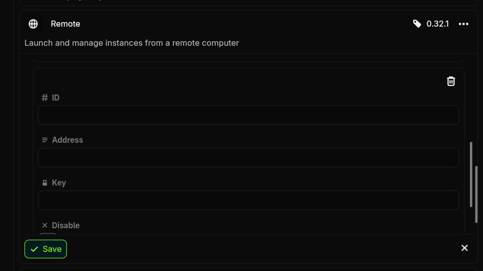

# Remote
ID: `remote`

The Remote plugin allows you to control and launch instances running on another computer.

## Usage

>>> Setting up the Server

To start you must set up a running remote server where you want to control. This can only be done from the CLI.

### Access Keys
To promote security, you need to create an access key that remote clients can use to connect. You can make as many keys as you want, and each one has its own permissions for what it is able to do.

First create a new key with a unique ID (can be whatever you want) by running `nitro remote key add <id>`. By default, this will create a key with all permissions, but you can add flags to choose only a subset of the available privileges.

When you want to see the value of the secret key string for later, run `nitro remote key show <id>`.

### Running the Server
Now that you have created an access key, you can run `nitro remote start`, preferably in some long-running terminal over SSH, tmux session, or Docker entrypoint.

By default, the server will listen on port `1112`, but this can be configured with the `nitro remote set-port <port>` command. You may have to configure your firewall (with something like `sudo ufw allow`) in order to let connections through.
>>> Connecting a Client

On your client machine (local computer), you now need to add the remote server as an option.

+++ App
Navigate to your app settings, and then go to the plugins tab and select `Configure` from the dropdown on the `Remote` plugin.

+++ CLI
Run `nitro plugin edit remote`. The schema looks like this:
```
{
	"remotes": [
		{
			"id": "...",
			"address": "...",
			"key": "..."
		}
	]
}
```
+++

Set the ID to a unique string to use locally to scope instances from that remote server. You can add as many remote servers as you want.

The address should be the network address of the remote server, without `http://`, `https://`, or any port number.

The key should be the secret key string of the access key you were given from the remote server.
>>> Using

Currently, you can launch, update, kill, configure, check the status of, and view logs of instances. You can also configure templates.

You must synchronize your instances and templates every once in a while if you want them to stay updated to the state on the server.
+++ App
On the home page, click the synchronize button in the top right corner to synchronize instances and templates across all plugins.
+++ CLI
Run `nitro remote sync` to synchronize all remotes or `nitro sync` to synchronize instances and templates from all plugins.
+++

!!!info Note
Cancelling jobs will not be propagated. If you cancel a launch or update while it is running, the job will continue to run in the background.
!!!
>>>